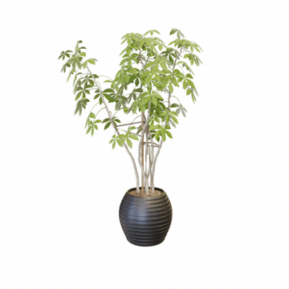
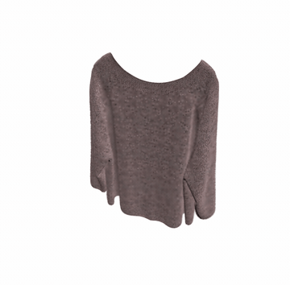
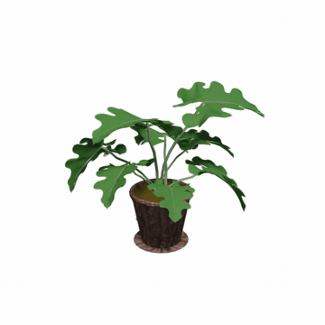
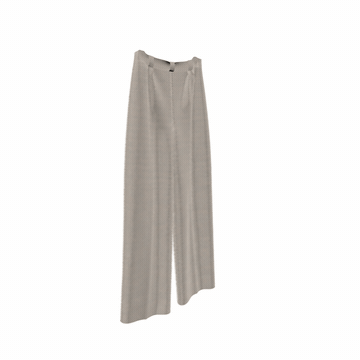
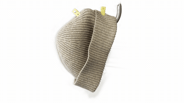
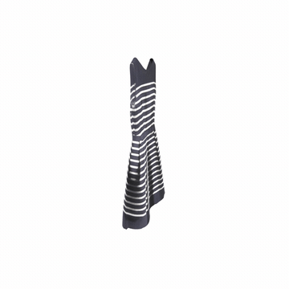

<div align="center">


### Physics-Informed Differentiable Modeling<br>of Wind-Driven Object Dynamics

**ICLR 2026**

Yuanhang Lei<sup>&#42;</sup>, Boming Zhao<sup>&#42;</sup>, Zesong Yang<sup>&#42;</sup>, Xingxuan Li, Tao Cheng,<br>
Haocheng Peng, Ru Zhang, Yang Yang, Siyuan Huang, Yujun Shen, Ruizhen Hu,<br>
Hujun Bao, Zhaopeng Cui<sup>†</sup>

[](https://zju3dv.github.io/DiffWind/)
[](https://arxiv.org/abs/2603.09668)
[](https://openreview.net/forum?id=vKVzihkbQo)
[](LICENSE)

[Overview](#-overview) · [Installation](#-installation) · [Reconstruction](#-agent-reconstruction) · [Results](#-reconstruction-results) · [Citation](#-citation)

</div>

<p align="center">
  
</p>

## ✨ Overview

DiffWind represents wind as a grid-based physical field and objects as particle
systems derived from 3D Gaussian Splatting. Their interaction is modeled by MPM,
while an LBM solver supplies a fluid-dynamics constraint and wind force. The
differentiable simulator and renderer enable gradients from image-space losses
to the object state and force field.

<p align="center">
  
</p>

## 🍃 Forward simulation

Click a preview to open its video.

<table>
  <tr>
    <td align="center" valign="top" width="50%"><b>Ficus</b><br><a href="media/results/ficus_view0.mp4"></a></td>
    <td align="center" valign="top" width="50%"><b>Sweater</b><br><a href="media/results/sweater_view0.mp4"></a></td>
  </tr>
  <tr>
    <td align="center" valign="top" width="50%"><b>Potted Plant</b><br><a href="media/results/potted_plant_view0.mp4"></a></td>
    <td align="center" valign="top" width="50%"><b>Pants</b><br><a href="media/results/pants_view0.mp4"></a></td>
  </tr>
  <tr>
    <td align="center" valign="top" width="50%"><b>Alocasia</b><br><a href="media/results/alocasia_view0.mp4"></a></td>
    <td align="center" valign="top" width="50%"><b>Hat</b><br><a href="media/results/hat_view0.mp4"></a></td>
  </tr>
  <tr>
    <td align="center" valign="top" width="50%"><b>Dress</b><br><a href="media/results/dress_view0.mp4"></a></td>
    <td align="center" valign="top" width="50%"><b>Flag</b><br><a href="media/results/flag_view0.mp4"></a></td>
  </tr>
</table>

## 🛠️ Installation

**Python 3.7 · PyTorch 1.13.1 · CUDA 11.7 · Taichi 1.5.0**

```bash
git clone https://github.com/zju3dv/DiffWind.git
cd DiffWind
conda env create -f environment.yml
conda activate diffwind
python -m pip install ./third_party/diff-gaussian-rasterization
```

The rasterizer build uses your installed CUDA toolkit. Install `ffmpeg` to
encode rendered PNG sequences as MP4.

## 🚀 Quick start

Run a coupled forward simulation on GPU 0:

```bash
./scripts/run_potted_plant_forward.sh 0
```

For a short validation run:

```bash
./scripts/run_sweater_forward.sh 0 --frames 2 --mpm_iter_cnt 1 --warmup_steps 2 --lbm_steps 1 --no_video
```

<details>
<summary><b>All scenes and command-line options</b></summary>

```bash
./scripts/run_ficus_forward.sh 0
./scripts/run_sweater_forward.sh 0
./scripts/run_potted_plant_forward.sh 0
./scripts/run_pants_forward.sh 0
./scripts/run_alocasia_forward.sh 0
./scripts/run_hat_forward.sh 0
./scripts/run_dress_forward.sh 0
./scripts/run_flag_forward.sh 0
```

- `--frames N`: number of output frames (default: 100).
- `--wind_frames N`: stop applying coupled LBM wind at frame `N` (default: 50).
- `--mpm_iter_cnt N`: override the per-frame MPM substeps from the scene config;
  this is useful for a lightweight smoke test.
- `--save_state`: save per-frame MPM particle states.
- `--save_fields`: save 128³ wind-force and occupancy fields.
- `--no_video`: keep PNG frames without invoking `ffmpeg`.
- `OUTPUT_DIR=/path`: override the wrapper's default output directory.

Outputs are written under `outputs/<scene>/render_wind_couple/` or
`outputs/<scene>_multiview/multiview/`.

</details>

## 🏋️ Agent reconstruction

The reconstruction harness fits a per-frame force field from four training
views, starting each frame from zero force and continuing the simulated state.
It automatically adjusts the learning rate, rolls back unsuccessful updates,
and propagates gradients through both Gaussian positions and deformations.
Static Gaussian appearance and scene physics are fixed.

Use the organized WD-Objects evaluation data:

```text
paper_evaluation/<scene>/gt/{train_view0..3,test_view0..3}/00001.png ... 00048.png
```

Run from the repository root:

```bash
python -m reconstruction train --scene potted_plant \
  --data-root /path/to/WD-Objects/paper_evaluation \
  --output outputs/reconstruction/potted_plant --gpu 0
```

Scene presets are in [`configs/reconstruction/`](configs/reconstruction/):
`potted_plant`, `ficus`, `sweater`, `pants`, `alocasia`, `flag`, and `dress`.
The Plant data directory is named `shapenet_plant`. Add `--resume` to continue
an interrupted run. A short smoke test can use `--frames 1 --min-updates 2
--max-updates 2`.

After all 48 frames, the harness freezes the forces, replays from rest, and
writes held-out renders and `evaluation/metrics.json`.

## 📊 Reconstruction results

Test-view PSNR in dB, averaged over 192 native-resolution PNGs per scene
(48 frames × four held-out views).

| Scene | Paper ↑ | Agent reconstruction ↑ | Gain ↑ |
| :--- | ---: | ---: | ---: |
| Plant | 52.54 | **63.69** | +11.15 |
| Ficus | 48.82 | **57.96** | +9.14 |
| Sweater | 41.72 | **56.74** | +15.02 |
| Pants | 58.38 | **65.68** | +7.30 |
| Alocasia | 44.94 | **60.43** | +15.49 |
| Flag | 41.86 | **55.50** | +13.64 |
| Dress | 41.76 | **56.17** | +14.41 |

> [!NOTE]
> WD-Objects sequences are generated by rendering simulated 3D Gaussian motion.
> Reconstruction uses the same static Gaussian representation and rendering
> model, so accurate motion and deformation alignment can yield high PSNR.
> This differs from reconstruction datasets that also require recovering
> geometry and appearance from photographs.

<details>
<summary><b>🗂️ Repository layout</b></summary>

```text
assets/                         Released Gaussian and filling PLY files
configs/                        Per-scene material and simulation settings
gaussian_renderer/              Differentiable Gaussian rendering interface
scene/                          Gaussian model and orbit cameras
simulator/                      Differentiable MPM and estimator/backward code
reconstruction/                 Automatic force fitting and frozen replay evaluation
third_party/diff-gaussian-.../  CUDA rasterizer with forward/backward kernels
HOME_LBM.py                     3D LBM fluid solver
simulate.py                     Coupled forward simulation entry point
render_multiview.py             Static multiview rendering entry point
scripts/                        Portable scene wrappers
```

See [`assets/README.md`](assets/README.md) for the released point counts.

</details>

## 📄 License

Original DiffWind code is licensed under [Apache 2.0](LICENSE).
Third-party components retain their respective licenses; see [THIRD_PARTY.md](THIRD_PARTY.md).

## 🙏 Acknowledgements

We thank the authors of the following projects:

1. [MPM](https://github.com/xuan-li/PAC-NeRF/blob/main/lib/engine/mpm_simulator.py)
2. [LBM](https://github.com/leqiqin/Computational-Biomimetics-of-Winged-Seeds/blob/main/LBM.py)
3. [3DGS](https://github.com/graphdeco-inria/gaussian-splatting)

## 📝 Citation

```bibtex
@inproceedings{lei2026diffwind,
  title     = {DiffWind: Physics-Informed Differentiable Modeling of Wind-Driven Object Dynamics},
  author    = {Lei, Yuanhang and Zhao, Boming and Yang, Zesong and Li, Xingxuan and Cheng, Tao and Peng, Haocheng and Zhang, Ru and Yang, Yang and Huang, Siyuan and Shen, Yujun and Hu, Ruizhen and Bao, Hujun and Cui, Zhaopeng},
  booktitle = {Proceedings of the Fourteenth International Conference on Learning Representations},
  year      = {2026},
  url       = {https://openreview.net/forum?id=vKVzihkbQo}
}
```
